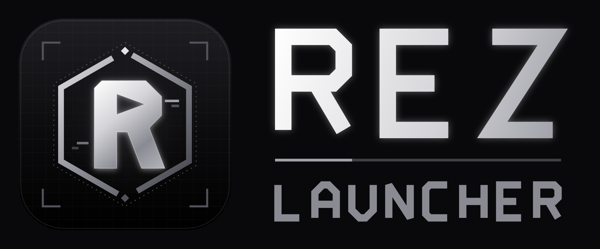

<p align="center">
  
</p>

<p align="center">
  <b>Le launcher de jeux PC open source, ultra-léger, qui chronomètre le temps passé sur chaque jeu, à la seconde près.</b><br/>
  Tauri v2 · Rust · TypeScript · Tailwind CSS · SQLite
</p>

---

## Pourquoi REZ launcher ?

- **Tous tes jeux au même endroit** : Steam, Epic, GOG, Battle.net, jeux sans launcher… une seule grille de jaquettes.
- **Temps de jeu par jeu** : un watcher Rust suit le processus du jeu et enregistre chaque session (en secondes) dans une base SQLite locale. Chaque jaquette affiche son propre compteur (« 42h 15m jouées »).
- **Nouveaux jeux détectés tout seuls** : installe un jeu, REZ launcher te propose de l'ajouter.
- **Mises à jour automatiques** : une pop-up te propose la nouvelle version, un clic pour l'installer.
- **Assistant « PC propre »** : un guide pas-à-pas en carrousel par launcher pour ranger tes disques (`D:\Jeux\BattleNet`, `D:\Jeux\Steam`…).
- **Léger** : pas d'Electron. Binaire natif de quelques Mo.

## 🛡️ Zéro risque de ban

REZ launcher est **strictement** un lanceur de raccourcis et un chronomètre :

| REZ launcher fait | REZ launcher ne fait **jamais** |
| --- | --- |
| Lancer l'exécutable via l'API de l'OS (`std::process::Command` / ShellExecute) | Injecter du code ou lire/écrire la mémoire d'un jeu |
| Lire la liste des processus (comme le Gestionnaire des tâches) | Écrire, modifier, déplacer ou supprimer un fichier de jeu, de dossier d'installation ou de launcher |
| Lire le nom et la version d'un `.exe` (comme Explorer › Propriétés) | Contourner un DRM ou un anti-cheat |
| Lire (sans les modifier) les manifestes d'installation Steam / Epic / GOG | Lancer un jeu par un autre moyen qu'un raccourci |

Supprimer un jeu de REZ launcher retire uniquement sa fiche : les fichiers sur le disque ne sont pas touchés.

## Fonctionnalités

- **Bibliothèque** : grille de jaquettes animée (glassmorphism noir & gris, tilt 3D), filtres **Tous / Installés / Non installés / Launchers**, recherche (`Ctrl+F`) et tri.
- **Temps par jeu** sous chaque jaquette, et dans son menu **Options** : temps total sur ce jeu, nombre de sessions, moyenne par session, dernière session, version, **Ouvrir l'emplacement**, modifier, supprimer.
- **Import** d'un jeu via son `.exe` (sélecteur natif ou **glisser-déposer**) : titre et version lus automatiquement.
- **Détection des nouveaux jeux** (voir plus bas) avec pop-up « Veux-tu l'ajouter à la bibliothèque REZ launcher ? ».
- **Launchers** : détection de Steam, Epic Games, Battle.net, Ubisoft Connect, GOG Galaxy, EA app, avec leurs logos ; bouton **Télécharger** (site officiel uniquement, URLs en liste blanche côté Rust) ; **guide interactif en carrousel** propre à chaque launcher.
- **Paramètres** : taille des jaquettes, animations, effet 3D, fond animé ; vérification des mises à jour ; dossiers de recherche des jeux ; lancement avec Windows ; onglet d'ouverture ; vidage du cache.

### Comment le temps de jeu est mesuré

1. « Jouer » → le backend lance l'exe et ouvre une session dans SQLite.
2. Une tâche `tokio` surveille le PID toutes les 2 s.
3. Beaucoup de jeux passent par un *bootstrapper* qui se ferme tout de suite : REZ launcher continue alors de suivre tout processus dont l'exécutable est **dans le dossier d'installation du jeu** (les dossiers génériques comme `steamapps\common` ou `D:\Jeux` sont exclus pour ne pas compter un autre jeu).
4. Toutes les 15 s, la session est sauvegardée (*heartbeat*) : en cas de crash du PC, le temps joué jusque-là est conservé.
5. À la fermeture : durée exacte enregistrée, temps du jeu recalculé depuis la somme de **ses** sessions, événement `game-stopped` émis vers l'UI.

> Les **launchers** (Steam, Epic…) restent dans la barre des tâches en permanence : ils sont lancés mais pas chronométrés.

### Comment les nouveaux jeux sont détectés

Toutes les 90 s (désactivable dans *Paramètres*), en **lecture seule** :

- **Steam** : `libraryfolders.vdf` + `appmanifest_*.acf` de chaque bibliothèque ;
- **Epic Games** : manifestes `ProgramData\Epic\EpicGamesLauncher\Data\Manifests\*.item` ;
- **GOG Galaxy** : registre `HKLM\SOFTWARE\WOW6432Node\GOG.com\Games` ;
- **Tes dossiers** (par défaut `X:\Jeux` et `X:\Games` s'ils existent) : un sous-dossier = un jeu, l'exécutable principal est choisi par heuristique (installateurs, redistribuables, crash reporters exclus).

Un jeu repéré déclenche une pop-up. « Oui » crée une fiche dans la bibliothèque (un raccourci interne), « Non » ne le propose plus (réactivable dans *Paramètres*).

## Installation

1. Va sur la page [**Releases**](https://github.com/reztsk/REZ-LAUNCHER/releases/latest).
2. Télécharge **`REZ-launcher_x.y.z_x64-setup.exe`** et lance-le.
   - Installation pour ton compte uniquement (pas de droits admin) dans `%LOCALAPPDATA%\REZ launcher`.
   - Raccourci **bureau** + menu Démarrer avec l'icône REZ launcher.
   - Désinstallation propre depuis *Paramètres › Applications*.
3. Pas envie d'installer ? Prends **`REZ-launcher_x.y.z_x64_portable.exe`** et lance-le directement.

> L'exe n'est pas signé : si Windows SmartScreen bloque, clique sur *Informations complémentaires* › *Exécuter quand même*.

**Tu avais GameREZ (v0.1.0) ?** Installe REZ launcher : ta bibliothèque, tes sessions et tes jaquettes sont importées automatiquement au premier lancement. Tu peux ensuite désinstaller GameREZ depuis *Paramètres › Applications*.

### Mises à jour

REZ launcher vérifie GitHub Releases au lancement (désactivable) et depuis *Paramètres › Mises à jour*. Si une version plus récente existe, une pop-up propose **Installer** : l'installateur est téléchargé, sa signature vérifiée (minisign, clé publique intégrée à l'app), puis installé ; l'app redémarre toute seule.

### Publier une nouvelle version

1. Monte la version dans `src-tauri/tauri.conf.json`, `package.json` et `src-tauri/Cargo.toml`, et ajoute une section `## vX.Y.Z` dans `CHANGELOG.md` (elle sert de notes de version).
2. `git tag vX.Y.Z && git push origin vX.Y.Z`
3. Le workflow **Release** compile REZ launcher sous Windows, signe le paquet de mise à jour, et publie la release : installateur, exe portable et `latest.json` (lu par la mise à jour automatique).

Le secret GitHub `TAURI_SIGNING_PRIVATE_KEY` doit contenir la clé privée de signature (générée avec `npx tauri signer generate`). Sa clé publique est dans `src-tauri/tauri.conf.json` (`plugins.updater.pubkey`). **Ne perds pas la clé privée** : sans elle, les versions installées ne pourront plus se mettre à jour.

## Développement

Prérequis : [Node.js](https://nodejs.org) 20+, [Rust](https://rustup.rs) stable, et les [prérequis Tauri](https://tauri.app/start/prerequisites/) (WebView2 + MSVC Build Tools sous Windows).

```bash
npm install
npm run tauri dev      # app en mode développement
npm run tauri build    # installateur dans src-tauri/target/release/bundle/nsis/
npm test               # tests frontend (node:test)
npm run test:rust      # tests Rust (DB, watcher avec vrais processus, détection…)
```

`npm run dev` seul ouvre l'interface dans un navigateur avec des **données de démo** (backend simulé). Ajoute `?detect=3` ou `?update=1` à l'URL pour voir les pop-ups de détection et de mise à jour.

## Architecture

```
├─ assets/                  Logo (SVG sources + PNG haute résolution)
├─ public/                  Logo servi à l'UI
├─ scripts/
│  ├─ render-logo.mjs       Source du logo : SVG, PNG et image de l'installateur (npm run logo)
│  └─ release-assets.mjs    Fichiers de release + manifeste de mise à jour (CI)
├─ src/                     Frontend TypeScript + Tailwind
│  ├─ main.ts               Vues Bibliothèque / Launchers, formulaire, événements
│  ├─ settings-view.ts      Onglet Paramètres
│  ├─ guide-modal.ts        Guides en carrousel par launcher
│  ├─ detection.ts          Pop-up « nouveau jeu détecté »
│  ├─ updates.ts            Vérification + installation des mises à jour
│  ├─ api.ts                Bridge typé vers les commandes Tauri
│  ├─ guides.ts             Étapes des guides de rangement
│  ├─ launcher-logos.ts     Logos des launchers (Simple Icons, CC0)
│  ├─ format.ts             Formatage (temps de jeu, dates…)
│  ├─ ui.ts / icons.ts      Modales, toasts, icônes
│  └─ mock.ts               Backend simulé (navigateur uniquement)
└─ src-tauri/               Backend Rust
   └─ src/
      ├─ db.rs              SQLite : jeux, sessions, réglages, détections ; import des données GameREZ
      ├─ watcher.rs         Lancement + suivi des processus (tokio, sysinfo)
      ├─ detect.rs          Détection des jeux installés (lecture seule)
      ├─ settings.rs        Préférences utilisateur
      ├─ exe_info.rs        Lecture nom/version d'un .exe (API Windows, lecture seule)
      ├─ launchers.rs       Launchers connus, URLs officielles, détection
      └─ commands.rs        Commandes Tauri exposées au frontend
```

### Commandes Tauri

| Commande | Rôle |
| --- | --- |
| `list_games`, `add_game`, `update_game`, `delete_game` | CRUD bibliothèque |
| `launch_game(id)` | Lance le jeu et démarre son chrono |
| `running_games` | Sessions en cours |
| `open_folder(path)` | Ouvre l'explorateur Windows sur le dossier |
| `scan_executable(path?)` | Import d'un `.exe` (sélecteur natif si pas de chemin) |
| `pick_cover`, `pick_folder` | Choix d'une jaquette / d'un dossier de jeux |
| `list_launchers`, `open_launcher_download(id)` | Détection + page officielle |
| `list_drives`, `create_folder(path)` | Assistant de rangement |
| `get_settings`, `save_settings` | Préférences (et lancement avec Windows) |
| `pending_detections`, `scan_games_now`, `resolve_detections`, `reset_ignored_detections` | Détection des jeux installés |
| `check_update`, `install_update` | Mise à jour automatique |
| `clear_cache`, `open_data_dir`, `open_repo` | Données |

Événements : `game-started`, `game-stopped` (`{ game, session_seconds }`), `games-detected`, `update-progress`.

### Données

Base SQLite dans `%APPDATA%\io.github.rezlauncher\rez-launcher.sqlite3` :

- `games` : `id, title, executable_path, install_dir, cover_image_url, version, playtime_minutes, category ('installed' | 'not_installed' | 'launcher'), added_at, last_played_at`
- `sessions` : `id, game_id, started_at, ended_at, duration_seconds, active`
- `settings` : préférences (JSON)
- `detections` : jeux repérés sur le disque et réponse de l'utilisateur (`pending`, `seen`, `ignored`, `added`)

## Contribuer

Les PR sont bienvenues. Avant d'ouvrir une PR : `npm run build && npm test && npm run test:rust`.
Toute contribution doit respecter la règle d'or : **aucune interaction avec la mémoire ou les fichiers des jeux.**

## Licence

[MIT](LICENSE). Icônes : [Lucide](https://lucide.dev) (ISC). Logos des launchers : [Simple Icons](https://simpleicons.org) (CC0) ; les marques appartiennent à leurs propriétaires respectifs.
